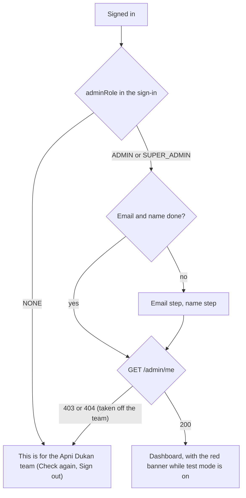
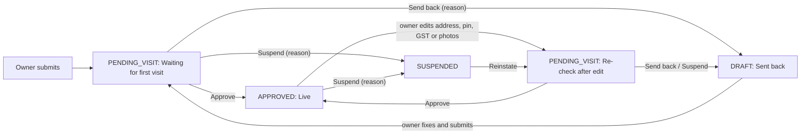

# Apni Dukan Admin

The website the Apni Dukan team uses: the field team visits new and edited shops and approves them, sends them back
or suspends them; support looks up a customer's strikes; the super admin manages the team and the OTP test mode. It
is phone-first (the field team uses it on the street), dark only, and talks only to
[apni-dukan-backend](https://github.com/Premanshu-jha/apni-dukan-backend) (the admin API from the backend PR "Admin
roles, OTP test mode, field-visit pages").

| Who | How they get in | What they see |
| --- | --- | --- |
| Admin (`adminRole: ADMIN`) | The super admin adds their number in Team | Shops (dashboard, lists, shop pages and decisions), Support, More |
| Super admin (`SUPER_ADMIN`) | Set on the backend | Everything an admin sees, plus Team and Test mode |
| Anyone else (`NONE`) | Signs in like everywhere else | "This is for the Apni Dukan team" and Sign out, nothing more |

Shop owners use the partner app; customers use the customer app.

## Run it on your laptop

You need Node 22 and the backend running (on your laptop at `http://localhost:8080`, or on Railway).

```bash
npm ci
cp .env.example .env.local     # then edit the values
npm run dev                    # http://localhost:5175 (5173 is the customer app, 5174 the partner app)
```

| Setting | What it is | Example |
| --- | --- | --- |
| `VITE_API_URL` | The backend's address, no trailing slash | `http://localhost:8080` or `https://apni-dukan-backend-production.up.railway.app` |
| `VITE_TURNSTILE_SITE_KEY` | Cloudflare Turnstile **site** key (public). Leave empty when the backend has no `TURNSTILE_SECRET_KEY` | `0x4AAAAAAA…` |

Both are public values baked into the page at build time. No secret ever goes in this app.

The backend must allow this site's address in `CORS_ALLOWED_ORIGINS`: add `http://localhost:5175` for local work,
and the deployed address once it is online. To get in the first time, your number must be the super admin on the
backend.

| Command | Does |
| --- | --- |
| `npm run dev` | Dev server with hot reload |
| `npm run typecheck` | TypeScript check |
| `npm run lint` | oxlint |
| `npm test` | Unit tests (Vitest) |
| `npx playwright install chromium` | Once: the browser for the end-to-end tests |
| `npm run e2e` | End-to-end tests (Playwright): a real browser drives the app against a fake backend |
| `npm run build` | Type-check and production build into `dist/` |

CI (`.github/workflows/ci.yml`) runs type-check, lint, unit tests, build, the end-to-end tests (on Ubuntu 24.04:
Playwright has no Chromium for `ubuntu-latest` yet) and a gitleaks secret scan on every pull request and on pushes
to `main` and `feature/**`.

### Tests

Every situation on this site is listed in [`docs/scenarios.md`](docs/scenarios.md): the journey, what the API
answers, what the screen shows, which test proves it, and a verdict. New work adds or updates rows there, and
reviews walk the list against the code.

- **Unit tests** (`src/**/*.test.ts`): groups, checklist and timeline labels, how long a shop has waited, India
  time and the test-mode banner, which decisions each status offers, form checks (reason 2–200, note up to 500,
  strike reason, test number, 1–8 hours), Maps and phone links, roles and tabs, error explanations, where sign-in
  goes next, plus the partner app's client and session tests.
- **End-to-end tests** (`e2e/`): Playwright on a phone-sized Chromium (Pixel 7, India time zone) against
  `e2e/mockApi.ts`, a fake backend at `http://api.test` that answers as the admin API contract says, status codes
  and error codes included. `.env.e2e` points the app at it, so tests never reach the internet. Journeys: sign-in,
  recovery, the email and name steps, not on the team, taken off the team, expired and refused sessions, dashboard
  and lists (loading, empty, no match, error, offline, search), the shop page, every decision with its checks,
  both 409s, double taps, notes, support, role guards, Team, Test mode and the banner. A failed run in CI keeps
  its traces.

## Screens

| Screen | Address | Who |
| --- | --- | --- |
| Sign in, code, recovery | `/signin`, `/signin/code`, `/signin/recover` | Everyone |
| Email and name steps | `/welcome/email`, `/welcome/name` | Admins who haven't given them yet |
| Dashboard: Kirana / Salon, five counts | `/?type=SALON` | Admins |
| Shop list for a type and group, with search | `/shops?type=KIRANA&group=FIRST_VISIT&q=` | Admins |
| Shop page: what changed, photos, details, Navigate, Call owner, timeline, decisions | `/shops/:id` | Admins |
| Support: a customer's strikes | `/support` | Admins |
| Team | `/team` | Super admin |
| Test mode | `/test-mode` | Super admin |
| More: profile, Sign out | `/more` | Admins |

## Flows

### Who gets in



### A shop's way through the field team



## How it works

### Folders

```
src/
  api/        client, errors, auth (copied from the partner app), admin.ts (one function per admin call, and the
              queries), types matching the contract
  app/        routes, guards (signed in, on the team, AdminGate with /admin/me, SuperAdminOnly), the shell
  components/ ui kit, code input, Turnstile (copied), Photo (tap to enlarge), Tabs, TestModeBanner
  features/   auth (sign-in steps, not on the team, sign-out), shops (dashboard, list, shop page, decision and
              note sheets), support, team, testmode, more
  lib/        India time, labels, rules (decisions and form checks), links, roles, phone, storage, device
e2e/          fake backend and journeys
docs/         scenarios.md
```

### Who is let in

The sign-in token's `user.adminRole` decides first: `NONE` sees "This is for the Apni Dukan team" on every address
and the app never calls `/admin` for them (nor runs the email and name steps). For admins, `AdminGate` loads
`GET /admin/me` and gives it to every screen; its role wins over the saved sign-in (it is the backend's current
one). Any admin call refused with 403 or 404 re-reads `/admin/me`, so someone taken off the team, or a super admin
made an ordinary admin, is moved on at once. `SuperAdminOnly` keeps ordinary admins out of `/team` and
`/test-mode`; the backend has the final say (`SUPER_ADMIN_ONLY`).

### Decisions

Every decision sends the shop's `version` as it was on screen when the sheet opened. If the owner changed the shop
meanwhile the backend answers 409 `SHOP_CHANGED`: the page says "The owner changed something; reload and check
again" with Reload, and keeps what was typed for the next try. 409 `WRONG_STATUS` (someone else decided first)
reloads the shop so its new buttons show. Each sheet locks while sending, so a double tap sends once.

### The test-mode banner

`/admin/me` is read every minute and on focus; the banner also checks its end time every 15 seconds, so it goes on
time. Any change on the Test mode screen re-reads `/admin/me` at once.

### Times and photos

Every time is India time (`lib/time.ts`). Photo links last a few minutes: the shop page is re-read every 4 minutes,
and a photo whose link ran out says so.

### Copied from the partner app

`src/api/client.ts`, `errors.ts` (plus the admin messages), `auth.ts`, `src/store/session.ts`,
`src/lib/{phone,storage,device,useNow}.ts`, `src/components/{ui,CodeInput,Turnstile,ErrorBoundary}.tsx` and
`src/features/auth/*` are copies of the partner app's, with this site's storage keys (`ada.*`) and wording. A fix in
one should go to the others until a shared package is worth it.

### Where the contract left something open

- **How long a shop has waited.** The list is sorted by when the shop entered its status, but `AdminShop` has no
  such field. The app reads `statusSince` if the backend sends it, and otherwise counts from `createdAt` (which can
  overstate a re-check's wait). Scenario 26 is a GAP until the backend adds it.
- **Removing a strike.** The contract gives no limits for `reason`; the app asks for 2–200 letters, like a decision.
- **Order of checks on a decision.** The fake backend checks fields (400), then the status (409 `WRONG_STATUS`),
  then the version (409 `SHOP_CHANGED`). The app handles each the same whatever the order.
- **403 code from the security config.** Not named in the contract; the fake uses `FORBIDDEN`. The app looks only at
  the status (403 or 404 on `/admin/me` = not on the team).

## Deploying

Any static host works (Cloudflare Pages, Vercel, Railway). Build command `npm run build`, output folder `dist`, and
set `VITE_API_URL` (and `VITE_TURNSTILE_SITE_KEY` in production). All routes must serve `index.html`
(`public/_redirects` does this where supported). Then add the site's address to the backend's
`CORS_ALLOWED_ORIGINS`. The page asks search engines not to index it. No service worker: it is not installable and
needs the network.

## Changelog

### 0.1.0 — 2026-11-05 (first version)

First version, against the admin API contract (merge the backend PR "Admin roles, OTP test mode, field-visit
pages" first):

- Sign-in, recovery, email and name steps and the session, copied from the partner app (own storage keys `ada.*`).
  Only `adminRole` ADMIN or SUPER_ADMIN gets in; anyone else sees "This is for the Apni Dukan team" and Sign out.
- A red banner on every screen while OTP test mode is on ("OTP test mode is on until 6:30 PM").
- Dashboard with Kirana / Salon tabs and five counts; shop lists with search and loading, empty, error and offline
  states.
- Shop page: what changed since the last approval, photos, details, Navigate, Call owner, timeline with admin-only
  notes; Approve, Send back, Suspend, Reinstate and Add note, with the checklist, reason and note checks, both 409s
  handled and double taps sending once.
- Support: a customer's strikes by phone, remove one with a reason.
- Super admin: Team (add, remove, refusals in words) and Test mode (test numbers, on for 1–8 hours, off).
- Unit and end-to-end tests in CI, and the scenario list in `docs/scenarios.md`.
