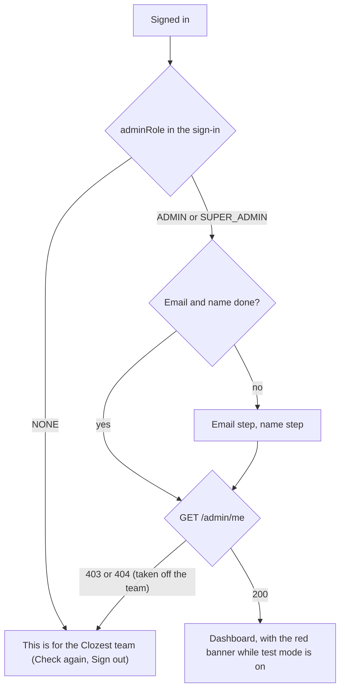
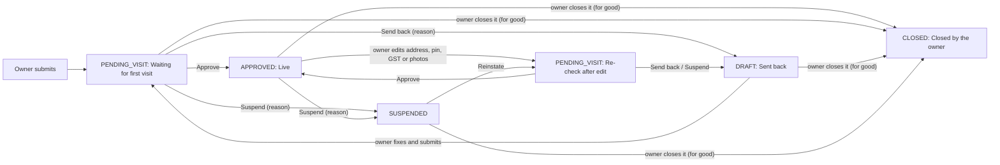

# Clozest Admin

The website the Clozest team uses: the field team visits new and edited shops and approves them, sends them back
or suspends them; support looks up a customer's strikes; the super admin manages the team and the OTP test mode. It
is phone-first (the field team uses it on the street), dark only, and talks only to
[apni-dukan-backend](https://github.com/Premanshu-jha/apni-dukan-backend) (the admin API from the backend PR "Admin
roles, OTP test mode, field-visit pages").

| Who | How they get in | What they see |
| --- | --- | --- |
| Admin, designation Field agent (`adminRole: ADMIN`, `designation: FIELD_AGENT`) | A super admin adds them in Team with their phone, email, name and the pincodes they cover | Only the businesses assigned to them (dashboard, lists, shop pages and decisions), More |
| Super admin (`SUPER_ADMIN`, no designation, no pincodes; there can be several) | Another super admin, in Team (the first one is set on the backend) | Every business, who visits each and assigning them, Support, Team (members and coverage) and Test mode |
| Anyone else (`NONE`) | Signs in like everywhere else | "This is for the Clozest team" and Sign out, nothing more |

Shop owners use the partner app; customers use the customer app.

## Run it on your laptop

You need Node 22 and the backend running (on your laptop at `http://localhost:8080`, or on Railway).

```bash
npm ci
cp .env.example .env.local     # then edit the values
npm run dev                    # http://localhost:5175 (5173 is the customer app, 5174 the partner app)
```

| Setting | What it is | Example |
| --- | --- | --- |
| `VITE_API_URL` | The backend's address, no trailing slash | `http://localhost:8080` or `https://apni-dukan-backend-production.up.railway.app` |
| `VITE_TURNSTILE_SITE_KEY` | Cloudflare Turnstile **site** key (public). Leave empty when the backend has no `TURNSTILE_SECRET_KEY` | `0x4AAAAAAA…` |

Both are public values baked into the page at build time. No secret ever goes in this app.

The backend must allow this site's address in `CORS_ALLOWED_ORIGINS`: add `http://localhost:5175` for local work,
and the deployed address once it is online. To get in the first time, your number must be the super admin on the
backend.

| Command | Does |
| --- | --- |
| `npm run dev` | Dev server with hot reload |
| `npm run typecheck` | TypeScript check |
| `npm run lint` | oxlint |
| `npm test` | Unit tests (Vitest) |
| `npx playwright install chromium` | Once: the browser for the end-to-end tests |
| `npm run e2e` | End-to-end tests (Playwright): a real browser drives the app against a fake backend |
| `npm run build` | Type-check and production build into `dist/` |
| `npm run icons` | Make the PNG icons from `public/icon.svg` (commit them) |

CI (`.github/workflows/ci.yml`) runs type-check, lint, unit tests, build, the end-to-end tests (on Ubuntu 24.04:
Playwright has no Chromium for `ubuntu-latest` yet), the security-headers check (Caddy), `npm audit` (high and
critical) and a gitleaks secret scan on every pull request and on pushes to `main` and `feature/**`. Dependabot
proposes npm and GitHub Actions updates weekly.

### Tests

Every situation on this site is listed in [`docs/scenarios.md`](docs/scenarios.md): the journey, what the API
answers, what the screen shows, which test proves it, and a verdict. New work adds or updates rows there, and
reviews walk the list against the code.

- **Unit tests** (`src/**/*.test.ts`): groups, checklist and timeline labels, how long a shop has waited, India
  time and the test-mode banner, which decisions each status offers, form checks (reason 2–200, note up to 500,
  strike reason, test number, 1–8 hours), Maps and phone links, roles and tabs, error explanations, where sign-in
  goes next, plus the partner app's client and session tests.
- **End-to-end tests** (`e2e/`): Playwright on a phone-sized Chromium (Pixel 7, India time zone) against
  `e2e/mockApi.ts`, a fake backend at `http://api.test` that answers as the admin API contract says, status codes
  and error codes included. `.env.e2e` points the app at it, so tests never reach the internet. Journeys: sign-in,
  recovery, the email and name steps, not on the team, taken off the team, expired and refused sessions, dashboard
  and lists (loading, empty, no match, error, offline, search), the shop page, every decision with its checks,
  both 409s, double taps, notes, support, role guards, Team, Test mode and the banner. A failed run in CI keeps
  its traces.

## Screens

| Screen | Address | Who |
| --- | --- | --- |
| Sign in, code, recovery | `/signin`, `/signin/code`, `/signin/recover` | Everyone |
| Email and name steps | `/welcome/email`, `/welcome/name` | Admins who haven't given them yet |
| Dashboard: Kirana / Salon, six counts | `/?type=SALON` | Admins |
| Shop list for a type and group, with search, 50 at a time ("Show more shops"); All / Unassigned for waiting groups | `/shops?type=KIRANA&group=FIRST_VISIT&q=&who=UNASSIGNED` | Admins (a field agent: their own only) |
| Shop page: what changed, photos, details, Navigate, Call owner, timeline, decisions; "Visit by" with Assign / Reassign | `/shops/:id` | Admins (Assign: super admin) |
| Tickets: mine (Waiting on us / on them / Resolved); super admins: everyone's, Unassigned, by person | `/tickets?view=OPEN&who=` | Support people, super admin |
| A ticket: who asked (account, business, latest bookings), the conversation, reply / Send & resolve, Close without reply, Give to someone else | `/tickets/:id` | Support people (their own), super admin |
| Strikes: a customer's strikes | `/support` | Super admin |
| Team: members (Edit, Move waiting visits, Remove) and Coverage (pincode → agents) | `/team`, `/team?view=coverage` | Super admin |
| Add or edit a member: phone, email, name, role, designation, pincodes (chips) | `/team/new`, `/team/:id` | Super admin |
| Test mode | `/test-mode` | Super admin |
| More: profile, Sign out | `/more` | Admins |

## Flows

### Who gets in



### A shop's way through the field team



A closed shop is never opened again (its owner registers a new one): no decision applies to it (the backend answers
409 `WRONG_STATUS`), only notes. A hand-over to a new owner doesn't move the shop; its timeline says "Handed over to …".

## How it works

### Folders

```
src/
  api/        client, errors, auth (copied from the partner app), admin.ts (one function per admin call, and the
              queries), types matching the contract
  app/        routes, guards (signed in, on the team, AdminGate with /admin/me, SuperAdminOnly), the shell
  components/ ui kit, code input, Turnstile (copied), Photo (tap to enlarge), Tabs, TestModeBanner
  features/   auth (sign-in steps, not on the team, sign-out), shops (dashboard, list, shop page, decision and
              note sheets), support, team, testmode, more
  lib/        India time, labels, rules (decisions and form checks), links, roles, phone, storage, device
e2e/          fake backend and journeys
docs/         scenarios.md
```

### Who is let in

The sign-in token's `user.adminRole` decides first: `NONE` sees "This is for the Clozest team" on every address
and the app never calls `/admin` for them (nor runs the email and name steps). For admins, `AdminGate` loads
`GET /admin/me` and gives it to every screen; its role wins over the saved sign-in (it is the backend's current
one). Any admin call refused with 403 or 404 re-reads `/admin/me`, so someone taken off the team, or a super admin
made an ordinary admin, is moved on at once. `SuperAdminOnly` keeps ordinary admins out of `/team` and
`/test-mode`; the backend has the final say (`SUPER_ADMIN_ONLY`).

### Decisions

Every decision sends the shop's `version` as it was on screen when the sheet opened. If the owner changed the shop
meanwhile the backend answers 409 `SHOP_CHANGED`: the page says "The owner changed something; reload and check
again" with Reload, and keeps what was typed for the next try. 409 `WRONG_STATUS` (someone else decided first)
reloads the shop so its new buttons show. Each sheet locks while sending, so a double tap sends once.

### The test-mode banner

`/admin/me` is read every minute and on focus; the banner also checks its end time every 15 seconds, so it goes on
time. Any change on the Test mode screen re-reads `/admin/me` at once.

### Times and photos

Every time is India time (`lib/time.ts`). Photo links last a few minutes: the shop page is re-read every 4 minutes,
and a photo whose link ran out says so.

### Copied from the partner app

`src/api/client.ts`, `errors.ts` (plus the admin messages), `auth.ts`, `src/store/session.ts`,
`src/lib/{phone,storage,device,useNow}.ts`, `src/components/{ui,CodeInput,Turnstile,ErrorBoundary}.tsx` and
`src/features/auth/*` are copies of the partner app's, with this site's storage keys (`ada.*`) and wording. A fix in
one should go to the others until a shared package is worth it.

### Long timelines and the search box

A shop's page shows the first 50 timeline entries; "Show earlier entries" asks `GET /admin/shops/{id}/timeline` with
the page's `timelineNext` (then each answer's `next`), exactly as received, 50 at a time, as the shop list's "Show
more shops" does (failed or offline taps keep what is shown, focus moves to the first new entry, `aria-busy`). The
earlier entries are kept under their own key, the shop page's `timelineNext`: refreshing the shop page doesn't ask them
again (old entries don't change), and when a note or decision pushes the first 50 down, `timelineNext` changes and the
earlier entries are asked again right after the new first 50, as many pages as the admin had loaded; the timeline as
it was stays on screen until they are in (nothing drops or jumps, nothing missing or twice). Entries far off screen aren't
drawn (`content-visibility`).

The search box sends nothing for 1 or 2 letters that aren't a shop number ("7" and "#42" are fine at any length): the
backend refuses those (they match most shops), so the whole list stays with the hint "Type at least 3 letters". If
the backend refuses one anyway, the list says the same instead of "Try again".

### Where the contract left something open

- **403 code from the security config.** Not named in the contract; the fake uses `FORBIDDEN`. The app looks only at
  the status (403 or 404 on `/admin/me` = not on the team).

(Waiting time, the order of checks and the text rules were open in the first contract; the updated contract fixes
them and the app follows it.)

### Two admins, stale pages and weak networks

A decision answered 409 `SHOP_CHANGED` or `WRONG_STATUS` refreshes the dashboard, the lists and the shop, and turns
the decision buttons off until a reload works (a failed reload keeps the banner). `WRONG_STATUS` re-reads the shop at
once and says what it is now. A decision whose answer is lost re-reads the shop: if the shop already shows the
decision, that is a success; otherwise the form stays, with the offline message. Every admin write goes through one
path in `api/admin.ts` that re-reads `/admin/me` on 403 or 404.

### Security headers

`security-headers.ts` works them out from the build's variables; the build writes them to
`dist/security-headers.caddy`, which the `Caddyfile` imports (real response headers; the `<meta>` CSP is gone), and
`vite preview` (the end-to-end tests) sends the same. The dev server sends none (hot reload needs inline scripts).

| Header | Value |
| --- | --- |
| `Content-Security-Policy` | `default-src 'self'`; scripts from the site (plus `https://challenges.cloudflare.com` when the Turnstile key is set, also its frame); API calls only to `VITE_API_URL` (was any https address); images from the site, `data:`, `blob:` and `PHOTO_ORIGIN` (was any https address); video (the salon video) from the site and `PHOTO_ORIGIN`; styles allow inline (the Turnstile widget); no plugins; `frame-ancestors 'none'` |
| `Strict-Transport-Security` | `max-age=63072000; includeSubDomains` |
| `Referrer-Policy` | `strict-origin-when-cross-origin` |
| `X-Content-Type-Options` | `nosniff` |
| `Permissions-Policy` | everything off (`geolocation=()`, camera, microphone, payment, …): directions open Google Maps |

Every end-to-end test fails if the policy blocks anything. CI's `headers` job builds as for production, starts Caddy
with the `Caddyfile` (the build at `/app/dist`, as on Railway) and checks every header on the app, a deep link,
`sw.js`, the manifest and the offline page (`scripts/check-headers.mjs`).

### Installing and offline

`public/manifest.webmanifest` ("Clozest Admin", short "Clozest Team") lists the SVG icon and PNGs (192, 512,
maskable 512) plus `apple-touch-icon.png` for iPhone, all made from `public/icon.svg` by `npm run icons` (sharp);
commit the PNGs after changing the SVG. `public/sw.js` only keeps a small offline page (`offline.html`, its CSS and
the icon): opening the app without a connection shows "You're offline" with "Try again". Nothing else is cached (the
team always works on live data). A new version of `sw.js` waits after installing; the app shows "New version
available — Reload" and only that button switches over. Change `OFFLINE_CACHE` in `sw.js` when the offline page
changes.

## Deploying

Railway (a service that builds from `main`). `railway.json` picks Railpack, which sees a Vite site (no `start`
script), runs `npm run build` and serves `dist/` with Caddy, using this repo's `Caddyfile` instead of its default:
every address that isn't a file gets `index.html` (single-page app), `/health` answers 200, and every answer carries
the security headers. Keep the service's Start Command empty in Railway's settings: a start command turns Caddy (and
the headers) off. Set `VITE_API_URL` and `VITE_TURNSTILE_SITE_KEY` as the service's variables (they are read at build
time), `PHOTO_ORIGIN` (in production the account's exact `https://<account>.r2.cloudflarestorage.com`; default
`https://*.r2.cloudflarestorage.com`, where signed photo and video links point). Then
add the site's address to the backend's `CORS_ALLOWED_ORIGINS`. The page asks search engines not to index it.

## Changelog

### 0.11.0 — 2026-11-12

- **Find a ticket** (needs the backend's round-2 helpdesk, V47): the Tickets tab has a search box for a ticket number
  (CLZ-1042, or just 1042), a mobile number or an email. A support person finds only their own tickets.
- **"N other tickets from them"** on a ticket's page lists every ticket that person has sent.
- **Open again (no email)** on a resolved ticket, for when they come back by phone: it opens again and nobody is emailed.
- **Move open tickets** (Team, super admins): when a support person is away, move all their open tickets to one other
  support person, or share them among the others; a second tap confirms. Tickets are never given to the person who
  asked; the notice says how many stayed and why.
- **Test mode is under More**: a super admin now has five tabs, so the labels fit on small phones. The red test-mode
  line has "Turn it off", and Test mode has a back arrow.
- The search is kept in the address, so ← from a ticket comes back to the same results; a name or half-typed number
  says what can be searched instead of an error; a pasted email subject ("Re: [CLZ-1042] …") finds the ticket.

### 0.10.0 — 2026-11-12

- **Support tickets** (needs backend V46). Questions sent to support@clozest.in or from "Need help" in the customer and
  partner apps become tickets (CLZ-1001…). A new **Tickets** tab: a support person sees only the tickets given to
  them; a super admin sees everyone's, **Unassigned** (no support person yet), one person's (tap their name), and a
  "By person" table (waiting on us, waiting on them, resolved). The tab shows how many wait on you.
- **A ticket's page** (`src/features/tickets/TicketDetail.tsx`): who asked (the account, their business and latest
  bookings; an unknown email address says so), the conversation (their attachments stay in the support Gmail), the
  history, and a reply box: **Send reply** emails them and waits on them, **Send & resolve** also resolves it.
  What you type is kept in this browser until it is sent (leaving, a reload or a refusal never loses it). If they
  wrote again meanwhile the reply is refused, their new message shows and your reply stays. **Close without reply**
  (spam, a mistake) emails nobody; a super admin can **Give to someone else** (or Unassigned, or themselves).
  Banners say when an email is on its way, when one couldn't be sent, and when they deleted their account.
- **Support people on the Team page**: the designation **Support** (no pincodes: "Answers only the support tickets
  given to them"); their card shows open tickets; removing them or changing their designation says their open
  tickets go to the others. A support person sees only Tickets and More; business addresses take them to their
  tickets. Field agents keep keying on the FIELD_AGENT designation (assign lists, pincodes, Move waiting visits).
- The super admins' old **Support** tab (a customer's strikes) is now **Strikes** ("Customer strikes"), so it isn't
  confused with Tickets.
- After review: an email whose sender couldn't be proven says so ("confirm who it is"); a message that arrives
  while you type must be read before Send ("I've read it"); Close without reply sends what you've seen (refused if
  they wrote since); a ticket moved away while open says "This ticket isn't yours"; refusals and "Sent" show right
  above the buttons; unsent replies are kept per person and forgotten on sign-out; phones are tap-to-call; switching
  a field agent to Support warns their pincodes go; "Give to" shows how many each has not resolved.
- Scenarios 221–266 added in `docs/scenarios.md`.

### 0.9.0 — 2026-11-12

- **A live business's re-check while it stays live** (needs backend V41). A business whose owner changed a photo, the
  video, the GSTIN or the Udyam number now stays live and waits in "Re-check after edit". The decisions, Assign and
  "Unassigned" follow `waitingForVisit` (`src/lib/rules.ts`: `waitingForVisit`, `liveRecheck`) instead of the status
  alone. For a live re-check the choices are **Approve** ("Checked. The business stays live…") and **Ask the owner to
  fix** (`POST …/ask-to-fix`: it stays live and waits, the owner sees your reason; timeline "Asked the owner to fix");
  Send back is only for a first visit (it would take a working salon off the app). A lost answer counts as done only
  when the re-read shows it. With an older backend (no `waitingForVisit`) only PENDING_VISIT waits, as before.
- The Live list says "Last checked … ago" (its time is the last approval, also a re-check's).
- **The owner's address change request** (needs backend V44; `AddressSection.tsx`): an "Address change" badge on the
  list's card, and on the business page "The owner asks for a new address": the address now and the one asked for,
  each with its pin on Google Maps (and Navigate there), and how far the pin moves. **Approve** applies it (the sheet
  says so); **Decline the new address** asks for the reason the owner is told. A request changed or taken back
  meanwhile answers "This business changed…" and reloads.
- **Change address** on the business page (`PATCH /admin/shops/{id}/address`): the field team sets the address and
  pin themselves (typed, from this phone's location at the door, or starting from the owner's request, with "Check
  the pin on Google Maps"); the backend's limits are checked before sending, an unchanged address isn't sent, and the
  version from when the form was opened is sent, so a change made meanwhile is refused instead of overwritten (the
  form keeps what was typed). The owner is told.
- Scenarios 119, 156 and 206 updated; 201–205 and 207–220 added in `docs/scenarios.md`.

### 0.8.0 — 2026-11-11

- **New look from the Clozest logo.** The theme's colours (`src/index.css`) now come from the dark logo: background
  `#0b0f26`, surfaces `#121736`/`#1a2048`, the logo's blue `#3d5bff` on buttons, borders and focus rings (the main
  button fades into the pin's violet `#5b21e6`, with a soft blue glow), links `#8c9cff`, and `#ff8a1f`, a lighter cut
  of the logo's orange `#ff7a00`, as the highlight colour (it was sky blue). `src/theme.test.ts` checks the theme's
  text and button pairs are WCAG AA, now including white on the violet end of the button, and that brand blue is
  never used as text (it is under 4.5:1 on the navy; text in the brand's colour uses link).
- **The logo** (`src/components/Logo.tsx`) is drawn in code on the sign-in screens: the location pin is the "C", then
  "LOZEST" and the orange sparkle. Screen readers hear "Clozest Admin".
- **Poppins** (600, 700) for the logo and screen titles, bundled with the app (`@fontsource/poppins`), so the security
  headers' `font-src 'self'` still holds. Body text keeps the phone's own font.
- **Icons:** `public/icon.svg` is the new dark app icon; the PNGs, the manifest's colours, `theme-color` and the
  offline page follow. The service worker's offline store is `offline-v2`, so installed apps store the new offline page.
- Scenarios 5, 87 and 107 now say Clozest and point to the install and offline rows.
- Scenarios 195–200 in `docs/scenarios.md`.

### 0.7.0 — 2026-11-10

Needs the backend with V34–V36.

- **A salon's page** shows its registration document (which one, and Open), its opening hours (closed days named),
  its services with times and prices, and its rating so far. A new document after approval shows in What changed
  ("The owner sent a new Trade licence", or the kind it was and is now). The document is optional for salons: "None
  added" when there is none (customers see "Unregistered" on its card).
- **Registration documents.** The document section says whether it was checked (customers see "Registered" only
  then). **Mark as checked**, or **Remove** a wrong or expired one with the reason the owner is told. Approving a salon
  after its visit checks the document there, so **remove a wrong document before approving** (the salon itself can
  still be approved: the document is optional). A live salon that adds or changes one stays live; super admins see
  "Registration documents to check" under the Salon tab of Businesses.
- **Lists refresh themselves.** The dashboard counts, "Registration documents to check" and an open shop list are
  read again every 30 seconds while the tab is in front (and at once when it comes back), so a business registered or
  a document uploaded meanwhile shows up without a reload. A shop list refreshes on the timer while one or two pages
  are loaded; after a long "Show more" scroll it refreshes when the tab comes back. A shop's page stays at every 4
  minutes: each read signs new photo links, so a faster one would reload the photos and restart a playing video.

### 0.6.0 — 2026-11-09

- **Field agents and assignment.** Role (Admin or Super admin) and, for an admin, a designation: Field agent, the
  only one so far. Every field agent covers one or more pincodes. Existing admins become field agents with no
  pincodes (they see nothing until a super admin adds some). Several super admins are allowed.
- **Team page.** A super admin adds a member with phone, email, name, role and, for a field agent, pincodes. There
  is no code at adding: they confirm their phone and email at their next sign-in. Pincodes are typed one at a time
  (Add or Enter) and become chips with ×; a pasted list adds them all, says which were already there or not valid,
  and keeps at most 300. A super admin edits everything about any member, any time (a phone or email change signs
  them out; editing your own signs you out here), removes anyone but themselves, and moves all of an agent's
  waiting visits to another agent. A Coverage tab lists each pincode with its agents.
- **Who visits each business.** A business that starts waiting for a visit goes to the field agent covering its
  pincode with the fewest waiting visits (the longest on the team on a tie), never to someone who works in it;
  otherwise it is Unassigned. Shop lists show "Visit by"; an All / Unassigned choice on waiting groups; the shop
  page has Assign / Reassign for a super admin. Removing a pincode from an agent hands its waiting businesses on by
  the same rule.
- **A field agent** sees and decides only the businesses assigned to them (anything else is "not found"); their
  tabs are Businesses and More. **Support** is now for super admins only.
- Stale edits are refused ("Someone changed this member…" with Load the latest); a member removed meanwhile keeps
  the form and says nothing was saved. Needs the backend's field-agents version (V30–V32).

### 0.5.2 — 2026-11-08

- **Test emails** on the Test mode page, like the test numbers: add an email with whose it is, see whether it is
  in use, remove it. While test mode is on, a test account verifies a listed email with any 6-digit code (no email
  is sent). The example.com rule is gone, and the help text says simply that test numbers and test emails take any
  code. Needs the backend's "test emails" version; with an older backend the list stays empty.

### 0.5.1 — 2026-11-08

- The Test mode page now says test numbers can also use **any 6-digit email code** for an email like
  `name@example.com` (no email is sent); a real email address still needs the real code; it only works for accounts made in
  test mode, and recovery and deleting an account always need the real codes. Needs the backend's
  "email step in OTP test mode"; with an older backend the email code stays real.

### 0.5.0 — 2026-11-08

- The business page of a salon has a **Salon video** section: a player (`controls`, `playsinline`, metadata only until
  played) for the short video the owner recorded at registration, so the field team can watch the salon before the
  visit; "No video yet" when there is none. From the backend's `videoUrl` on `GET /admin/shops/{id}` (only there,
  never in lists; customers never see it). A new video on a live salon is listed in "What changed" ("The owner sent
  a new video. Watch it below."). Security headers: a new `media-src` allows playing it from `PHOTO_ORIGIN` (R2).
  Needs the backend's salon video; with an older backend the section shows "No video yet".
- The page reads a fresh link every 4 minutes, but the player keeps the address it loaded (a video being watched
  isn't stopped); it takes the newest only before it loaded or after it failed. A video the browser can't play (a
  phone's codec) shows "This video can't play here." with **Open video** (the same signed link, a new tab).
- **In production set `PHOTO_ORIGIN` to the account's exact `https://<account>.r2.cloudflarestorage.com`**: it then
  replaces the wildcard `https://*.r2.cloudflarestorage.com` in `img-src` and `media-src` (a unit test checks it).

### 0.4.1 — 2026-11-07

- Wording: the field-team app says "business" instead of "shop" on every screen (bottom bar "Businesses", page
  titles, search hint, empty states, "Show more businesses", decision texts, the "Business was shut" checklist item,
  error messages, the offline page), and "Front photo" for the shop photo. No behaviour change: routes (`/shops…`),
  API paths, fields and error codes stay as they are. Messages the backend writes itself are unchanged here.

### 0.4.0 — 2026-11-07

- Security headers as real response headers on Railway: a `Caddyfile` (Railpack serves the build with Caddy) with
  CSP, HSTS, Referrer-Policy, nosniff and Permissions-Policy, worked out from the build's variables
  (`security-headers.ts`); the CSP `<meta>` and the dev-server plugin that removed it are gone. The CSP is stricter:
  API calls only to `VITE_API_URL`, images only from `PHOTO_ORIGIN` (R2), Turnstile only when its key is set, and
  `frame-ancestors 'none'` (a `<meta>` CSP can't do that). CI starts Caddy and checks the headers. `railway.json`
  picks Railpack.
- Installable: a manifest, PNG icons (192, 512, maskable) and the iPhone icon from `icon.svg` (`npm run icons`); a
  service worker with only an offline page (nothing else cached) and "New version available — Reload".
- A refresh answered 409 `TRY_AGAIN` (another tab or request swapped the same token first) uses the newer token that
  was saved and retries the call once; never a loop.
- Dependabot (npm and GitHub Actions, weekly) and `npm audit --audit-level=high` in CI.
- CI: the build job's checkout keeps no token (`persist-credentials: false`), like the other jobs.
- Sign-in codes: 429 `TRY_LATER` (a network that must wait, backend #34's OTP back-off) shows "Too many tries from
  this network. Try again in N minutes." from `Retry-After`; `LOCKED_FOR_TODAY` (now only the guessing network) keeps
  the backend's words.
- Closed shops (backend apni-dukan-backend#34): a sixth group `CLOSED`, "Closed by the owner", on the dashboard and as
  a list ("Closed 3 days ago"); the status `CLOSED` with its label and a grey pill wherever a status shows (the shop
  page, "it is now …" after a `WRONG_STATUS`); no decision buttons for it. Timeline entries `CLOSED` ("Closed by Ravi
  (the owner)", with "Owner's reason:") and `HANDED_OVER` ("Handed over to …").
- 403 `OWN_SHOP` (an admin who works in that shop) on a decision or a note: "You work in this shop (as its owner, a
  helper or a barber), so you can't decide on it or write notes about it. Ask another admin." in the form; it doesn't
  re-read `/admin/me` (it isn't about this person's role).
- Tests: the fake backend has the `CLOSED` group and status, `closeShop`, and answers `OWN_SHOP` first for shops the
  admin works in; end-to-end the closed group and shop page, `OWN_SHOP` on a decision and a note, a hand-over entry.
- Tests: end-to-end headers, install icons and offline page; unit tests of the service worker, the update offer and
  the 409 refresh.

### 0.3.0 — 2026-11-06

Uses the backend's scale PR (apni-dukan-backend#33, "Pages (the exact contract)"; merge that first):

- Shop page: the first 50 timeline entries, then "Show earlier entries" (50 at a time from `timelineNext` / `next`);
  a failed or offline tap keeps what is shown and says so; focus moves to the first new entry; `aria-busy`. A new
  entry meanwhile re-asks as many earlier pages as were loaded, keeping the old ones on screen until then.
- Search: 1 or 2 letters (not a shop number) aren't sent; the box says "Type at least 3 letters (or a shop number
  like #42)". A 400 `{q}` from the backend says the same instead of "Try again".
- A failed read is retried after the backend's `Retry-After` (503 SERVICE_BUSY: 5 s), not after 1 s.
- Tests: the fake backend pages the timeline (at, then seq, to the microsecond), refuses half or unreadable timeline
  cursors, requires `type` and `group` (unknown values 400 BAD_REQUEST) and refuses short searches like the real one;
  end-to-end journeys for a long timeline with ties, exactly 50 and 51, a failed and an offline tap, a note while
  earlier entries are shown, the search hint and a refused search; unit tests of the search rule and the retry delay.

### 0.2.0 — 2026-11-06

Needs the backend's scale PR (apni-dukan-backend #31: list pages with `afterSince` and `afterId`, ETags):

- Shop lists come 50 at a time, longest waiting first, with "Show more shops" (was: at most 100, then "search to
  find a shop further down"). The next page asks after the last shop's `statusSince` (exactly as received) and id,
  until a page is shorter than 50. A new search, group or type starts again from the first page.
- "First 50 shops" / "N shops, longest waiting first"; the count is announced and focus moves to the first new shop.
  A failed "Show more shops" keeps the shops already shown and says so (offline too); the button stays focusable
  while it loads (aria-busy, "Loading more shops…").
- ETags: the API client keeps the last answer to each read in memory only (per person, at most 200 addresses), sends
  its ETag as `If-None-Match` and shows the kept data on a 304, so a screen re-read with nothing changed downloads
  nothing. Answers stay `no-store`; the memory is forgotten on sign-out, when the session ends and when another
  person signs in. A 304 is never an error and never retried.
- A 304 for which nothing is kept (a cache or proxy on the way, or the person signed out or changed while the
  read was on its way) is asked once more without `If-None-Match` and past any cache, instead of becoming an error.
- After an empty last page focus moves to the count (the button is gone); after a failed page it stays on the
  button. "You're offline" from a tap goes with a new search, group or type, or once a page loads.
- Tests: the fake backend pages like the real one (keyset, ties by id, 400 for half or unreadable cursors) and
  answers ETags and 304s the same way; end-to-end journeys for 120 shops over 3 pages, a failed page, exactly 50, a
  search starting over and a 304 refresh; unit tests of the ETag memory.

### 0.1.0 — 2026-11-05 (first version)

First version, against the admin API contract (merge the backend PR "Admin roles, OTP test mode, field-visit
pages" first):

- Sign-in, recovery, email and name steps and the session, copied from the partner app (own storage keys `ada.*`).
  Only `adminRole` ADMIN or SUPER_ADMIN gets in; anyone else sees "This is for the Clozest team" and Sign out.
- A red banner on every screen while OTP test mode is on ("OTP test mode is on until 6:30 PM").
- Dashboard with Kirana / Salon tabs and six counts; shop lists with search and loading, empty, error and offline
  states.
- Shop page: what changed since the last approval, photos, details, Navigate, Call owner, timeline with admin-only
  notes; Approve, Send back, Suspend, Reinstate and Add note, with the checklist, reason and note checks, both 409s
  handled and double taps sending once.
- Support: a customer's strikes by phone, remove one with a reason.
- Super admin: Team (add, remove, refusals in words) and Test mode (test numbers, on for 1–8 hours, off).
- Unit and end-to-end tests in CI, and the scenario list in `docs/scenarios.md`.
- After the independent reviews (contract update):
  - Two admins at once: 409 `WRONG_STATUS` re-reads the shop and says "Someone else decided meanwhile: it is now
    …"; 409 `SHOP_CHANGED` says the shop changed since it was opened (the owner or another admin). Both refresh the
    dashboard, lists and shop, and keep the decision buttons off until a reload works.
  - Weak network: a decision whose answer is lost re-reads the shop and shows success if it went through, otherwise
    keeps the form with the offline message.
  - Text rule for reasons, notes, test-number labels and strike reasons: at least 2 letters or digits after
    trimming (reason 2–200, note 2–500 when given, label 2–60, strike reason 2–200), sent cleaned.
  - New refusals in words: `INVALID_PHONE` (on the phone field), `STRIKE_NOT_FOUND`, `REAL_ACCOUNT`; new
    `TEST_PHONE` wording; a refresh refused with `TEST_MODE_OFF` signs out.
  - Waiting time from `statusSince`; Team shows when each person became an admin.
  - Test mode page states the rules: only numbers nobody has signed in with, any code only while on, email codes
    always real, test accounts signed out when it ends or the number is removed.
  - Writes refused with 403 or 404 re-read `/admin/me` at once.
  - No sideways scroll at 360 px with long names, notes and URLs; the photo dialog traps focus and returns it.
  - Sign-out clears the session and cache first and tells the backend in the background.
  - Support sends one lookup on a double submit.
  - Content-Security-Policy meta tag.
  - Tests rewritten so each proves its scenario row (clock-driven banner and `/admin/me`, cache cleared after
    sign-out, no-reload navigation), and new rows for weak networks, search by "#1042" and "+91", long names,
    shops with no photos, India time, `REAL_ACCOUNT`, test accounts signed out, removal mid-decision and the
    100-row cap.
